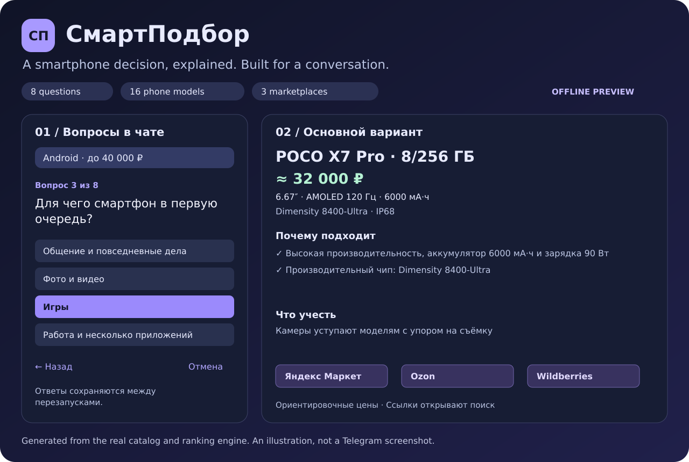

# СмартПодбор — инструкция

[English overview](../README.md) · [Архитектура](architecture.md) · [Пример работы](demo-example.txt)

Бот задаёт восемь вопросов на русском языке и предлагает до трёх разных
смартфонов с объяснениями и ссылками на поиск модели на Яндекс Маркете,
Ozon и Wildberries. В каталоге 16 моделей и 22 конфигурации памяти.



Это сгенерированная иллюстрация, не скриншот Telegram.

## Установка и демо

Нужен Python 3.11–3.14. Откройте терминал в корневой папке проекта.
На Windows используйте Ubuntu в WSL; в VS Code выберите терминал Ubuntu.

```bash
./setup.sh
./run.sh --demo --example
```

Установщик создаёт отдельное окружение `.venv` и устанавливает закреплённые
версии пакетов. `.env` создаётся только при отсутствии; существующий токен
не перезаписывается. Никакие соседние проекты не изменяются.

Чтобы самостоятельно ответить на вопросы:

```bash
./run.sh --demo
```

Вводите номер варианта. На первом шаге также можно ввести точный бюджет,
например `35000` или `35 тыс.`. Демо работает без токена и без Telegram.

## Запуск в Telegram

1. Откройте [@BotFather](https://t.me/BotFather) и отправьте `/newbot`.
2. Назовите бота «СмартПодбор» и выберите свободный username с окончанием `bot`.
3. Откройте `.env` в проекте и заполните `BOT_TOKEN=токен_из_BotFather`.
4. Выполните `./run.sh`, откройте своего бота в Telegram и отправьте `/start`.

Пока процесс работает, бот отвечает. Остановка — `Ctrl+C`. Бот обрабатывает
только личные чаты. С одним токеном запускайте один процесс.

Для VS Code в `.vscode/launch.json` есть два варианта запуска: демо и Telegram.
Локальное окружение Python выбирается через настройки проекта.

## Опрос

1. Максимальный бюджет: кнопкой или точной суммой.
2. Система: любая, Android или iPhone.
3. Основная задача: повседневные дела, камера, игры или работа.
4. Размер: любой, компактный до 6,4″ или большой от 6,65″.
5. Автономность: обычная или один из приоритетов.
6. Минимальная встроенная память: 128, 256 или 512 ГБ.
7. Обязательная функция: нет, Android с NFC для Mir Pay, IP67/IP68 или eSIM.
8. Предпочитаемая марка: любая, Samsung, Xiaomi/Redmi/POCO, Apple, HONOR, Google.

Бюджет, система, память и обязательная функция — строгие фильтры.
Размер, автономность и марка — пожелания: компромиссы описываются в карточках.
Если совпадений нет, бот объясняет причину, не меняя условия автоматически.

| Команда | Действие |
| --- | --- |
| `/start` | Приветствие или продолжение опроса |
| `/choose` | Новый подбор |
| `/back` | Предыдущий вопрос; последующие ответы заполняются заново |
| `/results` | Повторить готовую подборку |
| `/cancel` | Остановить опрос и удалить запись ответов |
| `/help` | Помощь |
| `/privacy` | Хранение данных |

## Настройки

```dotenv
BOT_TOKEN=токен_из_BotFather
DATABASE_PATH=data/smartpodbor.sqlite3
SESSION_TTL_HOURS=24
LOG_LEVEL=INFO
```

Переменные окружения важнее `.env`. SQLite сохраняет шаг и ответы между
перезапусками. Через 24 часа после последнего изменения сессия истекает;
просроченные строки удаляются при следующем обращении к базе.
`/cancel` удаляет запись из базы бота; история Telegram остаётся отдельно.

Для собственного каталога:

```bash
./run.sh --catalog path/to/phones.json --check
./run.sh --catalog path/to/phones.json --demo
```

Описание полей и обновления: [catalog.md](catalog.md).

## Проверки

```bash
make dev
make check
make preview
make build
```

`make check` проверяет стиль, тесты, покрытие, каталог и актуальность демо.
`make preview` обновляет иллюстрацию и текстовый пример из реального вывода.
`make build` проверяет состав wheel и исходного архива. Результаты локальной
проверки и границы проверки описаны в [validation.md](validation.md).

## Docker

После заполнения `.env`, при установленном Docker Compose:

```bash
docker compose up -d --build
docker compose logs -f bot
docker compose down
```

База хранится в именованном томе `bot-data`. Публичный порт и домен не нужны:
используется Telegram long polling. Не запускайте одновременно контейнер
и локальный процесс с одним токеном.

## Точность и авторство

Цены заданы вручную и служат ориентирами; наличие, доставка, продавцы и
пошлины не проверяются. Кнопки открывают поисковую выдачу, а не проверенную
карточку конкретного предложения. Сравнительные оценки 1–10 — редакционные.
Характеристики сверены по источникам производителей 25 октября 2026 года;
поддержка NFC и eSIM зависит от конкретной региональной версии.

Основа проекта — MIT-пример FSM-бота aiogram. Исходный пример сохранён;
анкета, подбор смартфонов, каталог, SQLite, ссылки магазинов, демо и проверки
добавлены в этом проекте. Подробнее: [атрибуция](../THIRD_PARTY_NOTICES.md)
и [разбор для портфолио](portfolio.md).
