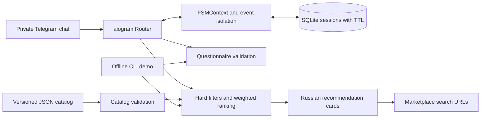
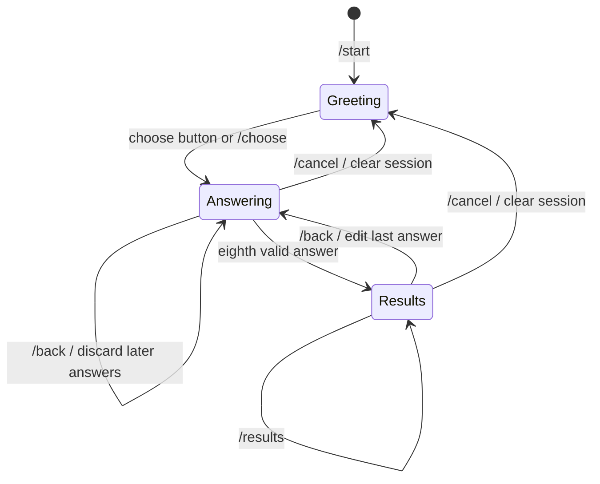

# Architecture and design decisions

SmartPodbor is a single-process asynchronous Telegram bot with a deterministic
recommendation engine and a local catalog. The public interface is Russian;
the package, tests, and developer documentation use English identifiers.



## The conversation



`questions.py` defines the eight questions once. Telegram buttons, accepted
answers, input validation, the terminal demo, and portfolio artifacts consume
that definition. A precise budget can also be typed as `35000` or `35 тыс.`.

Each question has a fresh random nonce. A callback contains that nonce, the
question index, and the selected option. The handler rejects callbacks from a
previous step. aiogram's `SimpleEventIsolation` serializes updates for each
session, preventing two fast clicks from advancing the survey twice.

`/start` resumes an active survey, `/choose` replaces it, `/back` discards the
answer being edited and subsequent answers, and `/cancel` deletes stored data.
Messages outside private chats are ignored.

## Recommendation policy

The engine first applies mandatory constraints:

- Indicative catalog price at or below the supplied budget.
- Selected operating system, when specified.
- Minimum built-in storage.
- Selected required feature: Android with NFC, IP67/IP68, or eSIM.

Only surviving configurations receive a score. The five editorial ratings are
camera, performance, endurance, screen, and software support, each from 1–10.
The chosen use case changes their weights. For example, gaming assigns weight
10 to performance; photography assigns weight 9 to camera. A battery priority
adds 7 to the endurance weight.

```text
base score = sum(rating × weight) / sum(weights)
final score = base + size preference + brand preference + small price bonus
```

Matching the requested size adds 1.4; a mismatch subtracts 1.4. The preferred
brand adds 0.8. The price bonus is `0.5 × (1 − price / budget)`. Ties are resolved
by price and configuration ID. Different storage configurations of one model
share one recommendation slot. At most three distinct models are returned.

These values are explicit policy choices, not measured prediction accuracy.
They live in `recommendations.py` and are covered by behavior tests. Reasons
and compromises are generated from the same model facts and preferences.
When nothing matches, the engine explains a conflicting requirement or the
lowest indicative price for an otherwise matching configuration.

## Persistence and concurrency

`SQLiteStorage` implements aiogram's `BaseStorage` interface. Keys include bot,
chat, user, and FSM destiny. Rows contain state, JSON answers, and an update
timestamp. A database index supports expiration cleanup. WAL mode and an
async connection keep storage work out of the event loop; a connection lock
serializes writes and failed writes roll back.

Sessions expire 24 hours after their last modification by default. Expired
rows are removed on the next database operation, including rows for users
who do not return. Normal process restarts preserve unfinished surveys.

Run one polling process per token. `SimpleEventIsolation` is process-local;
this design is not a distributed worker system. A larger deployment would
need shared event isolation and an appropriate shared state backend.

## Catalog boundaries

The package includes 16 models in 22 configurations. `load_catalog()` validates
metadata, types, score ranges, unique IDs, nonempty descriptions, and absolute
HTTPS source links before the bot starts. `--catalog PATH` loads an explicitly
supplied catalog through the same validation.

Prices are manual estimates, not live offers. Camera and endurance ratings
are editorial assessments, not laboratory results. Manufacturer links provide
specification context. Regional NFC, eSIM, battery, and SIM differences still
need checking on the seller's exact version.

Marketplace URLs contain the model/configuration query. The bot does not
transmit survey answers or Telegram IDs to a marketplace. It does not scrape
listings, validate sellers, calculate customs charges, or place orders.

## Validation strategy

- Domain tests exercise budget, OS, storage, and feature combinations and
  verify ranking changes for different priorities.
- Catalog tests reject invalid types, missing fields, duplicate IDs, invalid
  URLs, and corrupt files before any recommendation is produced.
- Conversation tests feed real aiogram updates through the dispatcher with a
  fake Telegram transport. They cover isolation, duplicate callbacks, editing,
  cancellation, restart recovery, and no-result conversations.
- CLI tests spawn real processes outside the source directory, with credentials
  disabled. Coverage also measures those subprocesses.
- Distribution checks inspect the wheel and source archive for the catalog,
  entry point, documentation, licenses, and excluded local files.

GitHub Actions is configured for Python 3.11 and 3.14, a wheel smoke test, and
a Docker smoke test without credentials. A workflow file alone is not evidence
that a hosted CI run or a live Telegram session has passed; see
[validation.md](validation.md) for the observed local results.
